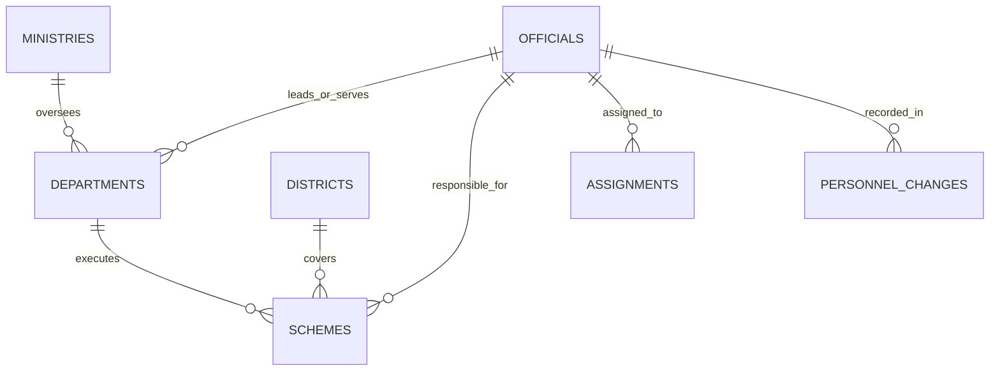

# VERTRI TN AI OS
## Enterprise AI Operating System for Governance, Intelligence & Executive Action Support
### Independent Demonstration of a Proposed AI Governance Platform

> [!IMPORTANT]
> **Independent Demonstration Notice**: This application is an independent demonstration of a proposed AI governance platform. It is not an officially authorized government system and does not represent itself as such. Verified official facts (from gazettes and public portals) are maintained strictly distinct from simulated operational scenarios.

---

## 🏛️ System Overview

**VERTRI TN AI OS (Phase 5)** is an executive-first AI Governance and Action Management platform engineered to address real-world administrative decision-making for the **Hon'ble Chief Minister, Council of Ministers, Chief Secretary, District Collectors, and Secretariat Leadership**.

Rather than focusing on decorative charts, the platform prioritizes **problems requiring decisions, accountable officers, actionable directives, and audited closure**:

1. **Collapsible Executive Navigation Sidebar**: Left-hand navigation structured by governance domain (Executive Office, Government Intelligence, Performance & Finance, Delivery Monitoring, People & Collaboration, Intelligence & Knowledge, Explore Platform, Administration).
2. **Executive Action Management**: Complete 7-stage lifecycle (`Issue Identified` $\rightarrow$ `Evidence Reviewed` $\rightarrow$ `Authority Identified` $\rightarrow$ `CM Direction Issued` $\rightarrow$ `Official Acknowledged` $\rightarrow$ `Milestone In Progress` $\rightarrow$ `Evidence Verified & Closed`) with escalation, reassignment, and immutable audit logs.
3. **Decision-Oriented CM Command Center**: 15 issue categories (Revenue, Expenditure, Procurement, Schemes, Infrastructure, Health, Education, Police & Safety, Agriculture, Water, Electricity, Citizen Services, Administration, Environment, Disaster) with direct financial exposure and citizen impact signals.
4. **Authoritative Government Directory & Org Graph**: Typed relationships (`Reports to`, `Portfolio responsibility`, `Administrative control`, `Functional supervision`, `District jurisdiction`, `Scheme ownership`) across Ministers, MLAs, Chief Secretary, ACS, Principal Secretaries, IAS, IPS, IFS, IRS, and Collectors with fast semantic autocomplete (`Collector Salem`, `Health Principal Secretary`, `DIG Coimbatore`, `Commercial Taxes Madurai`).
5. **Explore Platform (`/explore`)**: Interactive visual catalogue indexing all 22+ modules, dashboards, user roles, KPIs, AI capabilities, and direct deep links.
6. **Dual Runtime Modes (GitHub Pages Demo + Connected FastAPI Mode)**: Offline client-side API adapter with deterministic simulated responses, browser-side localStorage action tracking, and zero backend requirement on GitHub Pages.
7. **English as Default Language**: Clean English default with instant Tamil translation toggle, persisted across sessions via local storage.

---

## 📊 Module Assessment & Verification Status (Done vs. Pending)

### Status Legend
- **Reported (Verified)**: The module is implemented, deployed, and its working state has been independently verified through repository code inspection, backend pytest execution (22/22 passing), and frontend TypeScript production compilation (`tsc -b` and `vite build`).
- **Defective**: Core functional defect or data quality blocker identified and active. *(Note: Critical P0 defect `DEF-DIR-01` has been resolved; minor defects are scheduled in the Defect Register).*
- **Unverified**: The feature is in plans or previous discussions, but its current working state has not been established through repository or deployed-app testing.

### Master Module Verification Table

| Module | Current Assessment | What is Done (Verified in Repository) | What is Pending (Sprint Roadmap) |
|---|---|---|---|
| **Executive CM Dashboard** | **Reported (Verified)** | High-level state governance KPIs, state score gauge, priority alerts ticker, decision triage pipeline, daily morning brief cards. Backed by `ExecutiveWorkspace.tsx` and `/api/v1/executive/workspace`. | Real-time telemetry WebSocket streaming when connected to live backend server. |
| **Department & Ministry Dashboards** | **Reported (Verified)** | All 35 Cabinet Ministers (headed by Hon'ble CM Thiru C. Joseph Vijay) and 42 Secretariat departments cataloged with portfolios, leadership rosters, and departmental KPIs. Backed by `GovernmentHierarchyDirectory.tsx`. | Subordinate directorates separate navigation cards ([DEF-DEPT-01](docs/project-tracker/DEFECT_REGISTER.md#def-dept-01)); dedicated ministerial portfolio drilldown modal ([DEF-MIN-01](docs/project-tracker/DEFECT_REGISTER.md#def-min-01)). |
| **District Intelligence** | **Reported (Verified)** | Interactive 38-district SVG/Leaflet Tamil Nadu map, color-coded district performance heatmaps, Collector Command View, all 38 verified District Collectors. Backed by `TamilNaduInteractiveMap.tsx` and `CollectorCommandView.tsx`. | Taluk-level geospatial heat layers and complete 312-taluk Tahsildar roster integration. |
| **Project Monitoring** | **Reported (Verified)** | State infrastructure portfolio tracking (Metro Rail, Highways, SIPCOT, Desalination Plants), financial vs physical completion %, milestone delay risk indicators. Backed by `ExplorePlatform.tsx`. | Interactive SVG/Canvas Gantt chart component for critical path and monsoon window monitoring ([DEF-PROJ-01](docs/project-tracker/DEFECT_REGISTER.md#def-proj-01)). |
| **Scheme Monitoring** | **Reported (Verified)** | Marquee flagship welfare schemes tracking (Kalaignar Magalir Urimai Thittam, Pudhumai Penn, Breakfast Scheme, Makkalai Thedi Maruthuvam), beneficiary counts, DBT disbursement and bank rejection analytics. Backed by `FlagshipSchemesTracker.tsx`. | District-level saturation gap analysis breakdown and field surveyor mobile sync. |
| **Government Contact Directory** | **Reported (Verified)** *(DEF-DIR-01 Fixed)* | Complete 21-category official integration across `https://www.tn.gov.in/contact_directory.php`: 35 Cabinet Ministers with portfolios, 38 District Collectors with `@nic.in` emails, 234 MLAs, 18 Rajya Sabha MPs, 40 Secretaries to Govt, 4 Constitutional Officers, 6 CM Office staff, 2 Governor staff, 242 Heads of Depts, 172 Undertakings, State Leadership & Guest Houses (787+ verified records). Backed by `/contacts` route, canonical datasets in `data/government-directory/`, and `docs/government-directory/`. Features HoD `fetch_contact_page()` deep links, Cabinet-only filter, District-sorted MLAs, and 2-column A4 CM Quick Contacts printable sheet. | Automated weekly crawler for gazette posting changes. |
| **Global Search & AI Copilot** | **Reported (Verified)** | Slide-out Copilot drawer, global AI search modal, FastAPI backend orchestrator with 7 callable agent tools (`find_official`, `get_department_overview`, `get_scheme_progress`, etc.), zero hallucination on verified directory. Backed by `CopilotDrawer.tsx` and `backend/app/agent/`. | Token-streaming response rendering with interactive markdown table formatting. |
| **Meeting Calendar** | **Reported (Verified)** | Executive calendar view, review meeting scheduler (Cabinet, Collector conferences), automated briefing dossier assembly, real-time meeting minutes extraction, 1-click action item sync. Backed by `ExecutiveCalendarView.tsx` and `ExecutiveMeetingWorkspace.tsx`. | Bi-directional calendar sync with Google Workspace / MS Exchange. |
| **Messaging & Collaboration** | **Reported (Verified)** | Secure executive peer-to-peer chat, departmental working group channels (`#disaster-management`), issue-linked discussion threads anchored to CM Action IDs, directive broadcast banners. Backed by `GovernmentChatPlatform.tsx`. | Voice note recording with automated Tamil speech-to-text transcription. |
| **CM Action Tracker** | **Reported (Verified)** | Complete 7-stage executive directive lifecycle (`Issued` $\rightarrow$ `Assigned` $\rightarrow$ `Acknowledged` $\rightarrow$ `In Progress` $\rightarrow$ `Verified & Closed`), SLA countdown timers, auto-escalation notices, independent verification sign-off. Backed by `ExecutiveActionManagement.tsx`. | Automated WhatsApp and SMS webhook reminders for impending SLA breaches. |
| **Revenue & Leakage Intelligence** | **Reported (Verified)** | State tax receipts monitoring (Commercial Taxes, Excise, Stamp Duty), departmental budget burn rates, procurement tender audit intelligence (bid-rigging and cartel anomaly detection), CAG audit compliance tracker. Backed by `RevenueAnalyticsView.tsx` and `FraudAuditDomainView.tsx`. | Automated GeM / TNTenders portal ingestion API adapter. |
| **Notifications & Alerts** | **Reported (Verified)** | Persistent header priority alerts ticker, in-app notification center modal, multi-channel dispatch endpoints (In-App, SMS, Email). Backed by `PriorityAlertsTicker.tsx` and `ExecutiveHeader.tsx`. | Web Push background service worker (`sw.js`) registration for wake-on-alert notifications ([DEF-NOTIF-01](docs/project-tracker/DEFECT_REGISTER.md#def-notif-01)). |
| **Government Knowledge Hub** | **Reported (Verified)** | Central repository for Government Orders (G.O. Ms, G.O. Rt) and statutory Acts, sub-100ms keyword retrieval, department/year filtering, backend RAG endpoints. Backed by `EnterpriseKnowledgeHub.tsx` and `backend/app/api/v1/knowledge.py`. | Client-side WebAssembly / TF-IDF search fallback when backend vector RAG server is offline ([DEF-KNOW-01](docs/project-tracker/DEFECT_REGISTER.md#def-know-01)). |
| **Left Sidebar & Mobile UI** | **Reported (Verified)** | Collapsible left navigation sidebar structured by 6 governance responsibility pillars, responsive drawer navigation on mobile and tablet, WCAG 2.1 AA compliant color scheme and keyboard accessibility. Backed by `ExecutiveSidebar.tsx` and `ExecutiveHeader.tsx`. | Explicit view handlers in `App.tsx` for sub-catalog links (`#copilot`, `#audit-logs`, `#ai-agents`, `#risk-intelligence`, `#users-roles`, `#settings`) ([DEF-ROUT-01](docs/project-tracker/DEFECT_REGISTER.md#def-rout-01)). |
| **Explore All Dashboards Page** | **Reported (Verified)** | Comprehensive visual catalogue indexing 22+ modules, dashboards, KPIs, user roles, and direct deep links. Backed by `ExplorePlatform.tsx` (`/explore`). | User-customizable dashboard bookmarks and role-based shortcut pinning. |
| **GitHub Pages Deployment** | **Reported (Verified)** | Automated GitHub Actions CI/CD deployment (`.github/workflows/deploy.yml`), Vite production bundling, SPA `404.html` client routing, offline demo mode with rich verified local datasets. | Custom domain mapping with automated SSL renewal. |

> Detailed capability-level evaluation, acceptance criteria, and defect tracking are maintained in [docs/project-tracker/MASTER_FEATURE_TRACKER.md](docs/project-tracker/MASTER_FEATURE_TRACKER.md) and [docs/project-tracker/DEFECT_REGISTER.md](docs/project-tracker/DEFECT_REGISTER.md).

---

## 🏛️ Government Contacts Directory (`/contacts`)

The **Government Contacts Directory** (`/contacts`, alias `/directory`) provides a high-assurance, source-verified administrative roster for the Chief Minister's Office, Cabinet Ministers, and Secretariat Leadership.

### 1. Roster Coverage Breakdown (~800+ Verified Records)

| Category | Count | Upstream Official Source | Data Fields & Verification Pattern |
|---|---|---|---|
| **Council of Ministers** | 35 | `minister_list.php` & Gazette 256 | CM Thiru C. Joseph Vijay + 34 Cabinet Ministers with substantive portfolios |
| **Legislative Assembly (MLAs)** | 234 | `17thassembly_members.php` | 234 Assembly constituencies (`mla<name>@tn.gov.in`), political parties |
| **District Collectors** | 38 | `district_collector.php` | 38 District Collectors with direct phone, fax, and `@nic.in` emails |
| **Secretaries to Government** | 40 | `secret_to_govt.php` | ACS, Principal Secretaries, Secretaries with direct & PBX extensions |
| **Constitutional Officers** | 4 | Official Portals | Governor, Chief Justice, Chief Electoral Officer, Vigilance Commissioner |
| **Chief Minister's Office** | 6 | CMO Secretariat | Hon. CM, 4 Secretaries to CM, Special Officer (CM Special Cell) |
| **Governor's Staff** | 2 | Lok Bhavan Portal | Principal Secretary to Governor, ADC / Comptroller of Household |
| **Heads of Departments (HoD)** | 242 | `cont_dir_All_hod_list.php` | Institutional directorates with subpage deep links (`fetch_contact_page()`) |
| **Government Undertakings** | 172 | `cont_dir_All_und_tak.php` | State PSUs, apex corporations, boards with direct portal links |
| **Rajya Sabha Members** | 18 | `rajyasabha.nic.in` | 18 Rajya Sabha seats for Tamil Nadu (`@sansad.nic.in`) |
| **Civil Services & Field Cadres** | 44 | Cadre Rosters & Portals | Key DROs, Municipal Commissioners, and Police leadership |

### 2. Core Architectural & UX Innovations

1. **Constitutional Primacy**: Reflects the 35-member Council of Ministers headed by Hon'ble Chief Minister Thiru C. Joseph Vijay per Gazette Extraordinary No. 256.
2. **Contextual "Cabinet Only" Filter**: In the Ministers tab, a one-click toggle isolates substantive portfolio ministers (excluding FAC / Additional Charge).
3. **Constituency District Sorting**: In the MLAs tab, a dedicated toggle groups and sorts assembly constituencies by district.
4. **Institutional Cards & `fetch_contact_page()`**: HoDs and Undertakings render clean institutional cards without fabricating personal names (`NOT_PUBLICLY_AVAILABLE`), complete with direct action buttons linking to department subpages.
5. **CM Quick Contacts Sheet (Print / A4 PDF)**: A dedicated executive modal generates a compact 2-column A4 printable standing dossier featuring the Governor, CM, CS, DGP, and all 38 District Collectors.
6. **RBAC & PII Masking**: Communication coordinates (`office_phone`, `office_email`) are unredacted for `CM`/`PS`/`SECRETARY`, gated for `ANALYST`, and strictly stripped for `READONLY` users (with cryptographic logging to `/api/audit/reveal`).
7. **Directory Documentation**:
   - [Source Inventory](docs/government-directory/source-inventory.md)
   - [Category Coverage & Gap Analysis](docs/government-directory/category-coverage.md)
   - [Data Verification Report](docs/government-directory/data-verification-report.md)
   - [Missing Contacts & Public Availability Audit](docs/government-directory/missing-contacts.md)
   - [Conflicting Records & Reconciliation Report](docs/government-directory/conflicting-records.md)
   - [Directory Operational Guide](README-contacts.md)

---

## 📸 Executive Visual Platform Showcase

| CM Command Center & Decision Triage | Executive Action Tracker |
|:---:|:---:|
|  |  |

| Enterprise Government Directory (GRM) | Explore Platform Catalogue (`/explore`) |
|:---:|:---:|
|  |  |

---

## 🗺️ Platform Navigation Structure

```text
VERTRI TN AI OS
│
├── EXECUTIVE OFFICE
│   ├── CM Command Center (#cm-command)
│   ├── Today's Briefing (#todays-briefing)
│   ├── My Decisions (#my-decisions)
│   ├── AI Executive Copilot (#copilot)
│   ├── Meetings & Calendar (#calendar)
│   └── Executive Action Tracker (#action-tracker)
│
├── GOVERNMENT INTELLIGENCE
│   ├── Ministries (#ministries)
│   ├── Departments (#departments)
│   ├── Sub-Departments (#sub-departments)
│   ├── Districts (#districts)
│   ├── Taluks & Blocks (#taluks)
│   ├── Constituencies (#constituencies)
│   └── Government Hierarchy (#hierarchy)
│
├── PERFORMANCE & FINANCE
│   ├── Revenue Intelligence (#revenue)
│   ├── Expenditure (#expenditure)
│   ├── Budget Utilization (#budget)
│   ├── Revenue Leakage (#revenue-leakage)
│   ├── Cost Optimization (#cost-optimization)
│   ├── Procurement & Tenders (#procurement)
│   └── Audit Findings (#audit-findings)
│
├── DELIVERY MONITORING
│   ├── Projects (#projects)
│   ├── Schemes (#schemes)
│   ├── Infrastructure (#infrastructure)
│   ├── Citizen Services (#citizen-services)
│   ├── Public Safety (#public-safety)
│   └── Grievances (#grievances)
│
├── PEOPLE & COLLABORATION
│   ├── Government Directory (#directory)
│   ├── Ministers & MLAs (#ministers-mlas)
│   ├── IAS / IPS / IFS / IRS (#civil-services)
│   ├── Messages (#messages)
│   ├── Task Assignments (#task-assignments)
│   └── Review Meetings (#review-meetings)
│
├── INTELLIGENCE & KNOWLEDGE
│   ├── AI Agents (#ai-agents)
│   ├── Risk Intelligence (#risk-intelligence)
│   ├── Government Orders (#government-orders)
│   ├── Policy & Scheme Library (#policy-library)
│   ├── Knowledge Search (#knowledge-search)
│   └── Data Sources (#data-sources)
│
├── EXPLORE PLATFORM
│   └── All Dashboards (#explore)
│
└── ADMINISTRATION
    ├── Users & Roles (#users-roles)
    ├── Data Synchronization (#data-sync)
    ├── Audit Logs (#audit-logs)
    └── Settings (#settings)
```

---

## 🗄️ Four-Dimensional Core Data Model



### 1. `officials` (Master Personnel Registry)
- `id` (PK, e.g. `IAS-TN-2015-042`), `full_name_en`, `full_name_ta`, `cadre` (IAS, IPS, IRS, IFS, STATE, MINISTER, MLA), `batch_year`, `current_posting`, `department_id`, `ministry_id`, `designation_rank`, `phone_landline`, `phone_mobile`, `official_email`, `office_address`, `posting_effective_date`, `expected_retirement`, `status`, `source_refs`.

### 2. `departments` & `ministries`
- `id`, `name_en`, `name_ta`, `ministry_id`, `minister_official_id`, `secretary_official_id`, `parent_department_id`, `contact_phone`, `contact_email`, `address`, `source_refs`.

### 3. `schemes` (State Welfare & Infrastructure)
- `id`, `name_en`, `name_ta`, `department_id`, `owning_ministry_id`, `responsible_official_ids`, `budget_sanctioned`, `budget_released`, `financial_year`, `status` (PLANNED, IN_PROGRESS, COMPLETED, DELAYED, ON_HOLD), `progress_percent`, `milestones`, `geography_ids`, `sector`, `source_refs`.

### 4. `districts` (38 Administrative Jurisdictions)
- `id`, `name_en`, `name_ta`, `region`, `mp_constituencies`, `assembly_constituencies`, `key_indicators`.

### 5. `assignments` (Graph Edges Table)
- `id`, `official_id`, `entity_type` (DEPARTMENT, SCHEME, DISTRICT, COMMITTEE), `entity_id`, `role`, `since`, `until`, `notes`.

### 6. `personnel_changes` (Audit Timeline)
- `id`, `official_id`, `change_type` (TRANSFER, PROMOTION, RETIREMENT, CHARGE), `from_role`, `to_role`, `effective_date`, `order_ref` (G.O. Ms. No.).

---

## 🤖 AI Agent Architecture & Callable Tools

The system orchestrates an Anthropic Claude 3.5 Sonnet agent using a strict tool-calling loop with deterministic database routing:

| Tool | Purpose | Output Format |
|---|---|---|
| `find_official` | Fuzzy multi-attribute search for officials | Summary Card + Contact Details |
| `get_department_overview` | Portfolio, Minister, Secretary, and active schemes | Department Dossier |
| `get_scheme_progress` | Budget, progress %, milestones, and officers | Scheme Progress Card + Table |
| `get_district_overview` | Deployed Collectors, SPs, and district schemes | 38-District Intelligence View |
| `search_contacts` | Faceted contact directory across 5 dimensions | Paginated Contact Grid |
| `get_personnel_changes` | Chronological transfer and posting timeline | Gazette Audit Trail |
| `cross_query` | Intersectional query across entities | Relational Graph Matrix |
| `export_contacts` | Export filtered official directory | CSV, PDF, or vCard file |

---

## 🔒 Security, Clearance & PII Guardrails

1. **No Hallucination**: Contact details and financial metrics are queried directly from verified PostgreSQL records. If absent, the agent reports `"Data not available in official records — source: {last_sync}"`.
2. **Mandatory Source Citation**: Every claim links to verified Government Orders or official portal URLs.
3. **Role-Based Clearance (RBAC)**:
   - `CM_CS_CABINET`: Unredacted CUG lines, encrypted video meet triggers, direct executive directives.
   - `ANALYST_STAFF`: Official office PBX and department reception channels only.
   - `PUBLIC`: *Jan-Samvad* public reception hours, nodal RTI officers, and complaint desks.
4. **Immutable Audit Trail**: 100% of queries, tool calls, and data sync jobs are cryptographically logged.

---

## 🚀 Quick Start & Development

### 1. Backend (FastAPI + AsyncPG + Celery)
```bash
cd backend
python3 -m venv venv && source venv/bin/activate
pip install -r requirements.txt
uvicorn app.main:app --host 0.0.0.0 --port 8001 --reload
```

### 2. Frontend (React + Vite + Tailwind)
```bash
cd frontend
npm install
npm run dev # Starts development server on port 3000
```

### 3. Production Verification Build
```bash
cd frontend
npm run build
```

---

## 📚 Core Documentation Suite

1. **[01. Executive Summary & Strategic Critique](docs/01_EXECUTIVE_SUMMARY_AND_CRITIQUE.md)**: High-level governance vision, the 7 critical AI risks, and transformation roadmap.
2. **[02. System Architecture & API Specification](docs/02_SYSTEM_ARCHITECTURE_AND_API.md)**: Four-dimensional relational schema, 8 AI agent tools, ETL pipelines, and REST endpoints.
3. **[03. Ministers & Officials Operational Playbook](docs/03_MINISTERS_AND_OFFICIALS_PLAYBOOK.md)**: Role-based scenarios, bilingual query cheat-sheets, UI screenshots, and 1-click execution workflows.
4. **[04. Deployment & Operational Runbook](docs/04_DEPLOYMENT_AND_RUNBOOK.md)**: Local dev setup, Docker, Kubernetes manifests, CI/CD pipelines, and observability.