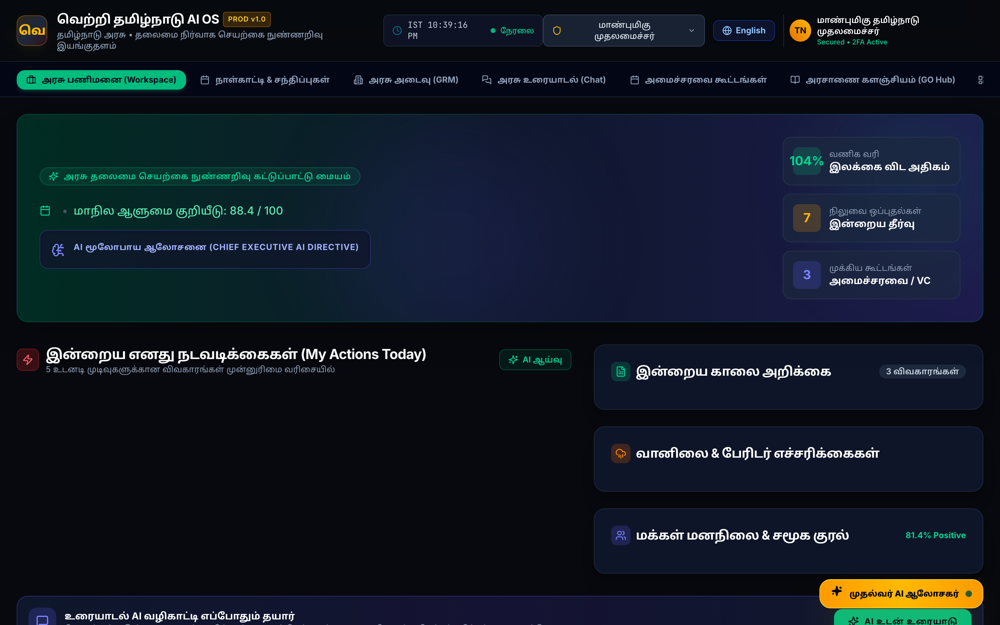
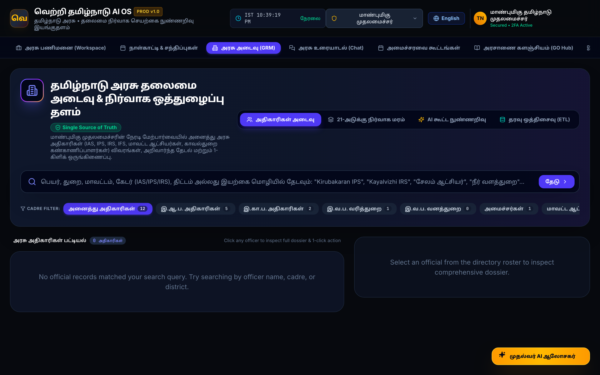
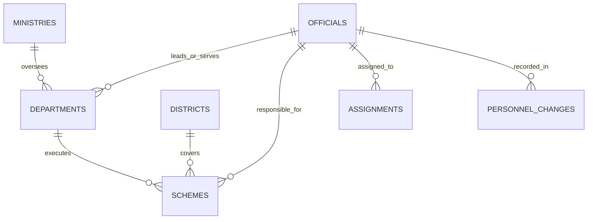

# VERTRI TN AI OS
## Enterprise AI Operating System for Governance, Intelligence & Executive Action Support
### Independent Demonstration of a Proposed AI Governance Platform

> [!IMPORTANT]
> **Independent Demonstration Notice**: This application is an independent demonstration of a proposed AI governance platform. It is not an officially authorized government system and does not represent itself as such. Verified official facts (from gazettes and public portals) are maintained strictly distinct from simulated operational scenarios.

---

## 🏛️ System Overview

**VERTRI TN AI OS (Phase 5)** is an executive-first AI Governance and Action Management platform engineered to address real-world administrative decision-making for the **Hon'ble Chief Minister, Council of Ministers, Chief Secretary, District Collectors, and Secretariat Leadership**.

Rather than focusing on decorative charts, the platform prioritizes **problems requiring decisions, accountable officers, actionable directives, and audited closure**:

1. **Collapsible Executive Navigation Sidebar**: Left-hand navigation structured by governance domain (Executive Office, Government Intelligence, Performance & Finance, Delivery Monitoring, People & Collaboration, Intelligence & Knowledge, Explore Platform, Administration).
2. **Executive Action Management**: Complete 7-stage lifecycle (`Issue Identified` $\rightarrow$ `Evidence Reviewed` $\rightarrow$ `Authority Identified` $\rightarrow$ `CM Direction Issued` $\rightarrow$ `Official Acknowledged` $\rightarrow$ `Milestone In Progress` $\rightarrow$ `Evidence Verified & Closed`) with escalation, reassignment, and immutable audit logs.
3. **Decision-Oriented CM Command Center**: 15 issue categories (Revenue, Expenditure, Procurement, Schemes, Infrastructure, Health, Education, Police & Safety, Agriculture, Water, Electricity, Citizen Services, Administration, Environment, Disaster) with direct financial exposure and citizen impact signals.
4. **Authoritative Government Directory & Org Graph**: Typed relationships (`Reports to`, `Portfolio responsibility`, `Administrative control`, `Functional supervision`, `District jurisdiction`, `Scheme ownership`) across Ministers, MLAs, Chief Secretary, ACS, Principal Secretaries, IAS, IPS, IFS, IRS, and Collectors with fast semantic autocomplete (`Collector Salem`, `Health Principal Secretary`, `DIG Coimbatore`, `Commercial Taxes Madurai`).
5. **Explore Platform (`/explore`)**: Interactive visual catalogue indexing all 22+ modules, dashboards, user roles, KPIs, AI capabilities, and direct deep links.
6. **Dual Runtime Modes (GitHub Pages Demo + Connected FastAPI Mode)**: Offline client-side API adapter with deterministic simulated responses, browser-side localStorage action tracking, and zero backend requirement on GitHub Pages.
7. **English as Default Language**: Clean English default with instant Tamil translation toggle, persisted across sessions via local storage.

---

## 📸 Executive Visual Platform Showcase

| CM Command Center & Decision Triage | Executive Action Tracker |
|:---:|:---:|
|  |  |

| Enterprise Government Directory (GRM) | Explore Platform Catalogue (`/explore`) |
|:---:|:---:|
|  |  |

---

## 🗺️ Platform Navigation Structure

```text
VERTRI TN AI OS
│
├── EXECUTIVE OFFICE
│   ├── CM Command Center (#cm-command)
│   ├── Today's Briefing (#todays-briefing)
│   ├── My Decisions (#my-decisions)
│   ├── AI Executive Copilot (#copilot)
│   ├── Meetings & Calendar (#calendar)
│   └── Executive Action Tracker (#action-tracker)
│
├── GOVERNMENT INTELLIGENCE
│   ├── Ministries (#ministries)
│   ├── Departments (#departments)
│   ├── Sub-Departments (#sub-departments)
│   ├── Districts (#districts)
│   ├── Taluks & Blocks (#taluks)
│   ├── Constituencies (#constituencies)
│   └── Government Hierarchy (#hierarchy)
│
├── PERFORMANCE & FINANCE
│   ├── Revenue Intelligence (#revenue)
│   ├── Expenditure (#expenditure)
│   ├── Budget Utilization (#budget)
│   ├── Revenue Leakage (#revenue-leakage)
│   ├── Cost Optimization (#cost-optimization)
│   ├── Procurement & Tenders (#procurement)
│   └── Audit Findings (#audit-findings)
│
├── DELIVERY MONITORING
│   ├── Projects (#projects)
│   ├── Schemes (#schemes)
│   ├── Infrastructure (#infrastructure)
│   ├── Citizen Services (#citizen-services)
│   ├── Public Safety (#public-safety)
│   └── Grievances (#grievances)
│
├── PEOPLE & COLLABORATION
│   ├── Government Directory (#directory)
│   ├── Ministers & MLAs (#ministers-mlas)
│   ├── IAS / IPS / IFS / IRS (#civil-services)
│   ├── Messages (#messages)
│   ├── Task Assignments (#task-assignments)
│   └── Review Meetings (#review-meetings)
│
├── INTELLIGENCE & KNOWLEDGE
│   ├── AI Agents (#ai-agents)
│   ├── Risk Intelligence (#risk-intelligence)
│   ├── Government Orders (#government-orders)
│   ├── Policy & Scheme Library (#policy-library)
│   ├── Knowledge Search (#knowledge-search)
│   └── Data Sources (#data-sources)
│
├── EXPLORE PLATFORM
│   └── All Dashboards (#explore)
│
└── ADMINISTRATION
    ├── Users & Roles (#users-roles)
    ├── Data Synchronization (#data-sync)
    ├── Audit Logs (#audit-logs)
    └── Settings (#settings)
```

---

## 🗄️ Four-Dimensional Core Data Model



### 1. `officials` (Master Personnel Registry)
- `id` (PK, e.g. `IAS-TN-2015-042`), `full_name_en`, `full_name_ta`, `cadre` (IAS, IPS, IRS, IFS, STATE, MINISTER, MLA), `batch_year`, `current_posting`, `department_id`, `ministry_id`, `designation_rank`, `phone_landline`, `phone_mobile`, `official_email`, `office_address`, `posting_effective_date`, `expected_retirement`, `status`, `source_refs`.

### 2. `departments` & `ministries`
- `id`, `name_en`, `name_ta`, `ministry_id`, `minister_official_id`, `secretary_official_id`, `parent_department_id`, `contact_phone`, `contact_email`, `address`, `source_refs`.

### 3. `schemes` (State Welfare & Infrastructure)
- `id`, `name_en`, `name_ta`, `department_id`, `owning_ministry_id`, `responsible_official_ids`, `budget_sanctioned`, `budget_released`, `financial_year`, `status` (PLANNED, IN_PROGRESS, COMPLETED, DELAYED, ON_HOLD), `progress_percent`, `milestones`, `geography_ids`, `sector`, `source_refs`.

### 4. `districts` (38 Administrative Jurisdictions)
- `id`, `name_en`, `name_ta`, `region`, `mp_constituencies`, `assembly_constituencies`, `key_indicators`.

### 5. `assignments` (Graph Edges Table)
- `id`, `official_id`, `entity_type` (DEPARTMENT, SCHEME, DISTRICT, COMMITTEE), `entity_id`, `role`, `since`, `until`, `notes`.

### 6. `personnel_changes` (Audit Timeline)
- `id`, `official_id`, `change_type` (TRANSFER, PROMOTION, RETIREMENT, CHARGE), `from_role`, `to_role`, `effective_date`, `order_ref` (G.O. Ms. No.).

---

## 🤖 AI Agent Architecture & Callable Tools

The system orchestrates an Anthropic Claude 3.5 Sonnet agent using a strict tool-calling loop with deterministic database routing:

| Tool | Purpose | Output Format |
|---|---|---|
| `find_official` | Fuzzy multi-attribute search for officials | Summary Card + Contact Details |
| `get_department_overview` | Portfolio, Minister, Secretary, and active schemes | Department Dossier |
| `get_scheme_progress` | Budget, progress %, milestones, and officers | Scheme Progress Card + Table |
| `get_district_overview` | Deployed Collectors, SPs, and district schemes | 38-District Intelligence View |
| `search_contacts` | Faceted contact directory across 5 dimensions | Paginated Contact Grid |
| `get_personnel_changes` | Chronological transfer and posting timeline | Gazette Audit Trail |
| `cross_query` | Intersectional query across entities | Relational Graph Matrix |
| `export_contacts` | Export filtered official directory | CSV, PDF, or vCard file |

---

## 🔒 Security, Clearance & PII Guardrails

1. **No Hallucination**: Contact details and financial metrics are queried directly from verified PostgreSQL records. If absent, the agent reports `"Data not available in official records — source: {last_sync}"`.
2. **Mandatory Source Citation**: Every claim links to verified Government Orders or official portal URLs.
3. **Role-Based Clearance (RBAC)**:
   - `CM_CS_CABINET`: Unredacted CUG lines, encrypted video meet triggers, direct executive directives.
   - `ANALYST_STAFF`: Official office PBX and department reception channels only.
   - `PUBLIC`: *Jan-Samvad* public reception hours, nodal RTI officers, and complaint desks.
4. **Immutable Audit Trail**: 100% of queries, tool calls, and data sync jobs are cryptographically logged.

---

## 🚀 Quick Start & Development

### 1. Backend (FastAPI + AsyncPG + Celery)
```bash
cd backend
python3 -m venv venv && source venv/bin/activate
pip install -r requirements.txt
uvicorn app.main:app --host 0.0.0.0 --port 8001 --reload
```

### 2. Frontend (React + Vite + Tailwind)
```bash
cd frontend
npm install
npm run dev # Starts development server on port 3000
```

### 3. Production Verification Build
```bash
cd frontend
npm run build
```

---

## 📚 Core Documentation Suite

1. **[01. Executive Summary & Strategic Critique](docs/01_EXECUTIVE_SUMMARY_AND_CRITIQUE.md)**: High-level governance vision, the 7 critical AI risks, and transformation roadmap.
2. **[02. System Architecture & API Specification](docs/02_SYSTEM_ARCHITECTURE_AND_API.md)**: Four-dimensional relational schema, 8 AI agent tools, ETL pipelines, and REST endpoints.
3. **[03. Ministers & Officials Operational Playbook](docs/03_MINISTERS_AND_OFFICIALS_PLAYBOOK.md)**: Role-based scenarios, bilingual query cheat-sheets, UI screenshots, and 1-click execution workflows.
4. **[04. Deployment & Operational Runbook](docs/04_DEPLOYMENT_AND_RUNBOOK.md)**: Local dev setup, Docker, Kubernetes manifests, CI/CD pipelines, and observability.