# 03 — Business Capability Map: Tamil Nadu Governance Architecture

> [!NOTE]
> This capability map represents the enterprise taxonomy of Tamil Nadu State Governance as operationalized in the VERTRI TN AI OS platform.

---

## 1. Enterprise Business Capability Hierarchy (Level 1 & Level 2)

```mermaid
graph TD
    TN[Tamil Nadu State Governance Engine] --> L1_EXEC[1. Executive Leadership & CMO]
    TN --> L1_MIN[2. Council of Ministers & Portfolios]
    TN --> L1_SEC[3. Secretariat Departments]
    TN --> L1_DIST[4. District Administration & Collectors]
    TN --> L1_FIN[5. Financial & Budgetary Governance]
    TN --> L1_GRM[6. Grievance Redressal & Public Services]
    TN --> L1_PMS[7. Infrastructure & Project Monitoring]
    TN --> L1_AI[8. AI Intelligence & Decision Support]

    L1_EXEC --> L2_EXEC1[1.1 Chief Minister Command Center]
    L1_EXEC --> L2_EXEC2[1.2 7-Stage CM Action Tracking]
    L1_EXEC --> L2_EXEC3[1.3 Executive Calendar & Time Allocation]

    L1_MIN --> L2_MIN1[2.1 Cabinet Portfolio Oversight]
    L1_MIN --> L2_MIN2[2.2 Inter-Ministerial Coordination]

    L1_SEC --> L2_SEC1[3.1 Secretariat Manual of Office Procedure]
    L1_SEC --> L2_SEC2[3.2 Head of Department HOD Supervision]
    L1_SEC --> L2_SEC3[3.3 Public Sector Undertaking PSU Governance]

    L1_DIST --> L2_DIST1[4.1 District Collector Review System]
    L1_DIST --> L2_DIST2[4.2 Taluk & Revenue Administration]
    L1_DIST --> L2_DIST3[4.3 234 Assembly Constituency Performance]

    L1_FIN --> L2_FIN1[5.1 State Budget Utilization]
    L1_FIN --> L2_FIN2[5.2 Procurement & Contract Monitoring]
    L1_FIN --> L2_FIN3[5.3 Fiscal Deficit & Debt Tracking]

    L1_GRM --> L2_GRM1[6.1 Mudhalvar Mukavari CM Helpline]
    L1_GRM --> L2_GRM2[6.2 SLA Escalation & Resolution]

    L1_PMS --> L2_PMS1[7.1 Special Projects Monitoring]
    L1_PMS --> L2_PMS2[7.2 Milestone & Delay Risk Analysis]

    L1_AI --> L2_AI1[8.1 Multi-Agent Executive Copilot]
    L1_AI --> L2_AI2[8.2 Natural Language Data Synthesis]
    L1_AI --> L2_AI3[8.3 Grounded Knowledge Hub RAG]
```

---

## 2. Core Value Streams

### 2.1 Citizen Grievance Intake to Resolution (Mudhalvar Mukavari)
1. **Intake**: Grievance submitted via Helpline 1100, online portal, or direct petition.
2. **Classification**: AI-assisted triage categorizes issue by department, district, and taluk.
3. **Assignment**: Automatic routing to designated District Collector or Department HOD.
4. **Resolution SLA**: Monitored with strict time-to-resolve bounds (default: 15 days).
5. **Quality Audit**: Direct verification phone call / SMS survey to citizen before ticket closure.

### 2.2 Cabinet Decision to Field Implementation
1. **Cabinet Approval**: Cabinet memorandum passed and recorded in Secretariat records.
2. **Government Order (G.O.)**: Respective department issues official G.O. (Ms. or Rt.).
3. **Financial Sanction**: Finance Department releases administrative and financial sanction.
4. **Field Execution**: District Collectors execute through line departments and local bodies.
5. **KPI Telemetry**: Real-time progress tracked in CM Command Center dashboard.

---

## 3. Capability Mapping to Technical Components

| Capability Domain | Sub-Capabilities | Primary Frontend View | Backend API Router | Data Store / Models |
|---|---|---|---|---|
| **Executive Office** | CM Command, Decisions, Announcements | [ExecutiveWorkspace.tsx](file:///Users/apple/projects/vetri-tncm-aios/frontend/src/components/ExecutiveWorkspace.tsx) | [cmo_endpoints.py](file:///Users/apple/projects/vetri-tncm-aios/backend/app/api/v1/cmo_endpoints.py) | `CMOActionItem`, `CMOAlert` |
| **Directory** | 787+ Officials (Ministers, Collectors, MLAs) | [GovernmentDirectoryView.tsx](file:///Users/apple/projects/vetri-tncm-aios/frontend/src/components/GovernmentDirectoryView.tsx) | [cmo_endpoints.py](file:///Users/apple/projects/vetri-tncm-aios/backend/app/api/v1/cmo_endpoints.py) | [verifiedGovernmentDirectory.ts](file:///Users/apple/projects/vetri-tncm-aios/frontend/src/data/verifiedGovernmentDirectory.ts) |
| **Finance** | State Budget, Outlays, Treasury | [StateBudgetDashboard.tsx](file:///Users/apple/projects/vetri-tncm-aios/frontend/src/components/StateBudgetDashboard.tsx) | [state_budget.py](file:///Users/apple/projects/vetri-tncm-aios/backend/app/api/v1/state_budget.py) | `BudgetHead`, `ExpenditureRecord` |
| **Districts** | 38 Districts, Revenue, Health, Law & Order | [DistrictsDashboard.tsx](file:///Users/apple/projects/vetri-tncm-aios/frontend/src/components/DistrictsDashboard.tsx) | [districts.py](file:///Users/apple/projects/vetri-tncm-aios/backend/app/api/v1/districts.py) | `DistrictMetric`, `CollectorScorecard` |
| **Grievance** | Mudhalvar Mukavari SLA & Heatmaps | [GrievanceRedressalView.tsx](file:///Users/apple/projects/vetri-tncm-aios/frontend/src/components/GrievanceRedressalView.tsx) | [grm.py](file:///Users/apple/projects/vetri-tncm-aios/backend/app/api/v1/grm.py) | `GrievanceRecord`, `GrievanceSLA` |
| **Calendar** | CM Schedule, Cabinet Meetings, Field Visits | [ExecutiveCalendarView.tsx](file:///Users/apple/projects/vetri-tncm-aios/frontend/src/components/ExecutiveCalendarView.tsx) | [calendar.py](file:///Users/apple/projects/vetri-tncm-aios/backend/app/api/v1/calendar.py) | `ExecutiveCalendarEvent` |
| **AI Copilot** | Multi-Turn Governance Intelligence | [ExecutiveCopilotView.tsx](file:///Users/apple/projects/vetri-tncm-aios/frontend/src/components/ExecutiveCopilotView.tsx) | [copilot.py](file:///Users/apple/projects/vetri-tncm-aios/backend/app/api/v1/copilot.py) | `ChatSession`, Vector Knowledge Store |
