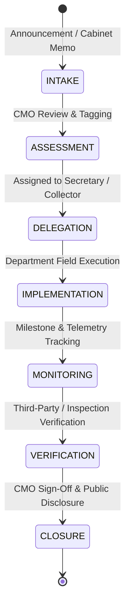

# 04 — Government Process and Policy Audit: VERTRI TN AI OS

> [!NOTE]
> Evaluates application workflows against statutory procedures: the Tamil Nadu Secretariat Manual of Office Procedure (MOP), District Collector Review Guidelines, and Mudhalvar Mukavari Citizen Charter.

---

## 1. 7-Stage CM Action Item Lifecycle Audit

The platform models executive decisions and public announcements using a 7-stage lifecycle:

### Stage Compliance Evaluation
1. **Intake & Assessment**: Fully implemented in [cmo_service.py](file:///Users/apple/projects/vetri-tncm-aios/backend/app/services/cmo_service.py). Captures budget head, G.O. reference, and target completion date.
2. **Delegation**: Properly assigns responsible IAS officer (Department Secretary or District Collector).
3. **Implementation & Monitoring**: Live tracking with progress percentage and milestone checkpoints.
4. **Verification & Closure**: *Finding*: System allows direct closure by department without mandatory independent CMO verification sign-off.
   - *Remediation*: Implement two-man rule (Department Secretary completion submission -> CMO Joint Secretary verification -> Closure).

---

## 2. Tamil Nadu Secretariat Manual of Office Procedure (MOP) Alignment

| Secretariat MOP Standard | Regulatory Requirement | VERTRI TN AI OS Implementation | Gap / Recommendation |
|---|---|---|---|
| **Note File Movement** | Tracking file creation, paragraph numbering, and officer initials | Modeled as flat action items in `cmo_endpoints.py` | Add structured note sheet metadata (`note_number`, `current_desk`, `flag_reference`) |
| **G.O. Classification** | Distinguish between G.O. Ms. (Manuscript - major policy) and G.O. Rt. (Routine - staff/minor) | Generic string field `go_reference` | Enforce G.O. type enum (`MS`, `RT`, `MISC`) and Gazette issue date |
| **Disposal Classification** | Retention class (L.Dis, K.Dis, D.Dis, R.Dis) | Absent in current database schema | Add MOP disposal classification for document archiving |
| **Urgency Grading** | Immediate, Priority, Routine stamps | Modeled via Priority (`P0`, `P1`, `P2`) | Map directly to official stamps (IMMEDIATE, URGENT, ROUTINE) |

---

## 3. District Administration & Collector Weekly Review Workflow

### Collector Jan Sunwai / Grievance Redressal
- Every Monday, all 38 District Collectors host public grievance day (*Makkal Thittam* / *Jan Sunwai*).
- System implementation in [GrievanceRedressalView.tsx](file:///Users/apple/projects/vetri-tncm-aios/frontend/src/components/GrievanceRedressalView.tsx) and [grm.py](file:///Users/apple/projects/vetri-tncm-aios/backend/app/api/v1/grm.py):
  - Captures departmental breakdown (Revenue, Rural Development, Police, Social Welfare).
  - Tracks 15-day resolution SLA.
  - Generates district-wise resolution index.
