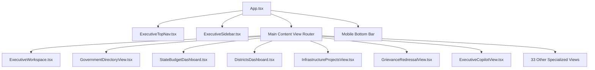

# 05 — Frontend Architecture and Code Review: VERTRI TN AI OS

> [!NOTE]
> Review covers both the primary active SPA dashboard in `frontend/` (Vite 6 + React 19 + Tailwind CSS v4) and the root `app/contacts/` Next.js prototype.

---

## 1. Frontend Architecture & Technology Stack

- **Build Tool & Framework**: Vite 6.0.7 with `@vitejs/plugin-react` (React 19.0.0, TypeScript 5.7.2).
- **Styling Architecture**: Tailwind CSS v4 (`@tailwindcss/vite` 4.0.0-beta.8), custom CSS variables in [index.css](file:///Users/apple/projects/vetri-tncm-aios/frontend/src/index.css).
- **Iconography & Visualization**: Lucide React 0.469.0, Apache ECharts 5.6.0 via `echarts-for-react` 3.0.2.
- **Routing Paradigm**: Hash-based client-side routing (`window.location.hash`) inside [App.tsx](file:///Users/apple/projects/vetri-tncm-aios/frontend/src/App.tsx).
- **State Management**: Zustand / Custom hook store in [useExecutiveStore.ts](file:///Users/apple/projects/vetri-tncm-aios/frontend/src/hooks/useExecutiveStore.ts).

---

## 2. Component Hierarchy & Layout Structure

---

## 3. Findings & Code Quality Analysis

### 3.1 Unhandled Client Routes (`DEF-ROUT-01` / `FIND-ROUT-01`)
In [App.tsx](file:///Users/apple/projects/vetri-tncm-aios/frontend/src/App.tsx#L85-L160), navigation routes `#audit-logs`, `#settings`, `#ai-agents`, `#risk-intelligence`, and `#users-roles` are present in [ExecutiveSidebar.tsx](file:///Users/apple/projects/vetri-tncm-aios/frontend/src/components/ExecutiveSidebar.tsx) but have no matching case in `App.tsx`, causing the workspace pane to render blank.
- **Remediation**: Add explicit view render cases in `App.tsx` with dedicated administrative components or informative telemetry panels.

### 3.2 Dual-Stack Prototype Disconnect
The repository contains Next.js App Router code under [app/contacts/page.tsx](file:///Users/apple/projects/vetri-tncm-aios/app/contacts/page.tsx) and [components/contacts/](file:///Users/apple/projects/vetri-tncm-aios/components/contacts/), while the primary application is built inside [frontend/](file:///Users/apple/projects/vetri-tncm-aios/frontend/).
- Root `package.json` specifies `"next dev"` and `"next build"` scripts, but `next` is not listed in root dependencies.
- **Remediation**: Maintain `frontend/` as the single canonical SPA for Vite and GitHub Pages deployment. Harmonize directory UI components to prevent split development efforts.

### 3.3 Large Monolithic Charting Chunk (`FIND-PERF-01`)
Vite build produces a single 1,027 kB chunk for ECharts and charting libraries.
- **Remediation**: Use dynamic `React.lazy()` imports for charting-heavy components (`StateBudgetDashboard`, `DistrictsDashboard`) and configure `manualChunks` in [vite.config.ts](file:///Users/apple/projects/vetri-tncm-aios/frontend/vite.config.ts).
