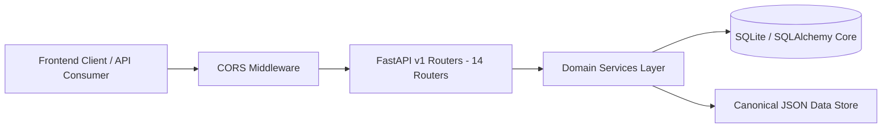

# 06 — Backend Architecture and Code Review: VERTRI TN AI OS

> [!NOTE]
> Detailed technical review of FastAPI modular monolith implementation in `backend/app/`.

---

## 1. Backend Stack & Router Topology

- **Web Framework**: FastAPI 0.115.0 with Uvicorn 0.32.0.
- **Data Validation & Modeling**: Pydantic v2 (2.9.2), SQLAlchemy 2.0.36.
- **Router Organization**: 14 routers mounted under `/api/v1/` prefix in [main.py](file:///Users/apple/projects/vetri-tncm-aios/backend/app/main.py).
- **Total Registered Endpoints**: 56 endpoints.

---

## 2. Comprehensive Endpoint Inventory & Auth Coverage Audit

| Router Module | Mount Prefix | Endpoints | Auth Dependency Applied? | Finding / Vulnerability |
|---|---|---|---|---|
| [auth.py](file:///Users/apple/projects/vetri-tncm-aios/backend/app/api/v1/auth.py) | `/auth` | 4 | Yes (on `/me`) | Normal public login endpoints |
| [cmo_endpoints.py](file:///Users/apple/projects/vetri-tncm-aios/backend/app/api/v1/cmo_endpoints.py) | `/cmo` | 15 | **NO (0 / 15)** | `FIND-SEC-01`: Anonymous access to action items, alerts |
| [calendar.py](file:///Users/apple/projects/vetri-tncm-aios/backend/app/api/v1/calendar.py) | `/calendar` | 4 | **NO (0 / 4)** | `FIND-SEC-01`: Anonymous access to booking, events |
| [grm.py](file:///Users/apple/projects/vetri-tncm-aios/backend/app/api/v1/grm.py) | `/grm` | 7 | **NO (0 / 7)** | `FIND-SEC-01`: Anonymous trigger of GRM data sync |
| [copilot.py](file:///Users/apple/projects/vetri-tncm-aios/backend/app/api/v1/copilot.py) | `/copilot` | 1 | **NO (0 / 1)** | `FIND-SEC-01`: Anonymous chat endpoint |
| [audit.py](file:///Users/apple/projects/vetri-tncm-aios/backend/app/api/v1/audit.py) | `/audit` | 1 | **NO (0 / 1)** | `FIND-SEC-01`: Anonymous reading of audit logs |
| [executive.py](file:///Users/apple/projects/vetri-tncm-aios/backend/app/api/v1/executive.py) | `/executive` | 4 | Yes (4 / 4) | Enforces `get_current_active_user` |
| [state_budget.py](file:///Users/apple/projects/vetri-tncm-aios/backend/app/api/v1/state_budget.py) | `/budget` | 4 | Yes (4 / 4) | Enforces `get_current_active_user` |
| [districts.py](file:///Users/apple/projects/vetri-tncm-aios/backend/app/api/v1/districts.py) | `/districts` | 4 | Yes (4 / 4) | Enforces `get_current_active_user` |
| [departments.py](file:///Users/apple/projects/vetri-tncm-aios/backend/app/api/v1/departments.py) | `/departments` | 4 | Yes (4 / 4) | Enforces `get_current_active_user` |
| [projects.py](file:///Users/apple/projects/vetri-tncm-aios/backend/app/api/v1/projects.py) | `/projects` | 4 | Yes (4 / 4) | Enforces `get_current_active_user` |
| [schemes.py](file:///Users/apple/projects/vetri-tncm-aios/backend/app/api/v1/schemes.py) | `/schemes` | 4 | Yes (4 / 4) | Enforces `get_current_active_user` |
| [knowledge.py](file:///Users/apple/projects/vetri-tncm-aios/backend/app/api/v1/knowledge.py) | `/knowledge` | 4 | Yes (4 / 4) | Enforces `get_current_active_user` |

> [!WARNING]
> **P0 Vulnerability**: Exactly **27 out of 56 endpoints** lack authentication dependencies. Unauthenticated users can trigger operations like `/api/v1/cmo/action-items` or `/api/v1/calendar/book`.

---

## 3. Database Layer & Data Seeding

- Uses SQLite (`cmo.db`) via SQLAlchemy sessions in [session.py](file:///Users/apple/projects/vetri-tncm-aios/backend/app/db/session.py).
- Seeding logic in [seed_cmo_data.py](file:///Users/apple/projects/vetri-tncm-aios/backend/app/db/seed_cmo_data.py) initializes default action items, alerts, and executive calendar events.
- **Target Architecture**: Migrate to PostgreSQL with `pgvector` for enterprise scale, ACID transactions, and semantic search capabilities.
