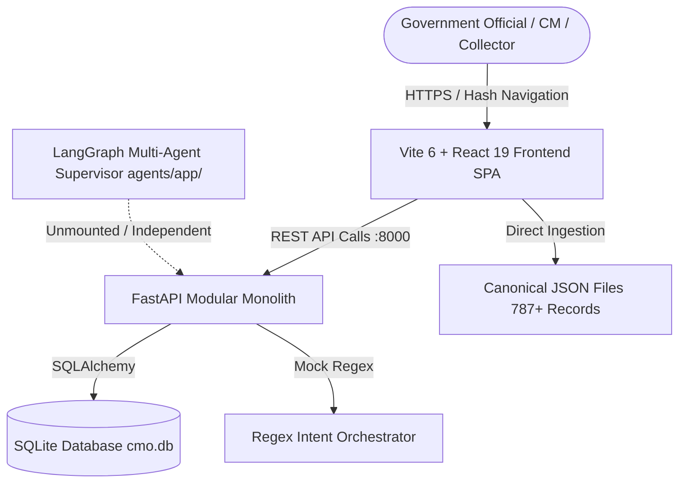

# 08 — Current Architecture (As-Is): VETTRI TN AI OS

> [!NOTE]
> Formal documentation of the existing as-is architecture, component boundaries, and operational runtime.

---

## 1. High-Level System Context

---

## 2. Runtime Subsystems

### 2.1 Frontend Runtime (`frontend/`)
- **Hosting**: GitHub Pages SPA deployment at `kiru6006.github.io/vetri-tncm-team-agent/`.
- **Navigation**: Hash-based router (`#cm-command`, `#directory`, `#districts`, etc.).
- **Data Ingestion**: Directly bundles official directory JSON files via TypeScript static imports in [verifiedGovernmentDirectory.ts](file:///Users/apple/projects/vetri-tncm-aios/frontend/src/data/verifiedGovernmentDirectory.ts).

### 2.2 Backend Runtime (`backend/`)
- **Host**: Uvicorn server running on `0.0.0.0:8000`.
- **API Surface**: 14 routers in `backend/app/api/v1/` with 56 endpoints.
- **Persistence**: Local SQLite database `cmo.db`.

### 2.3 Standalone Multi-Agent Supervisor (`agents/app/`)
- Contains LangGraph supervisor with specialist sub-agents (SQLite tool, knowledge search tool).
- Currently unmounted in production FastAPI routes; FastAPI falls back to regex simulation.
