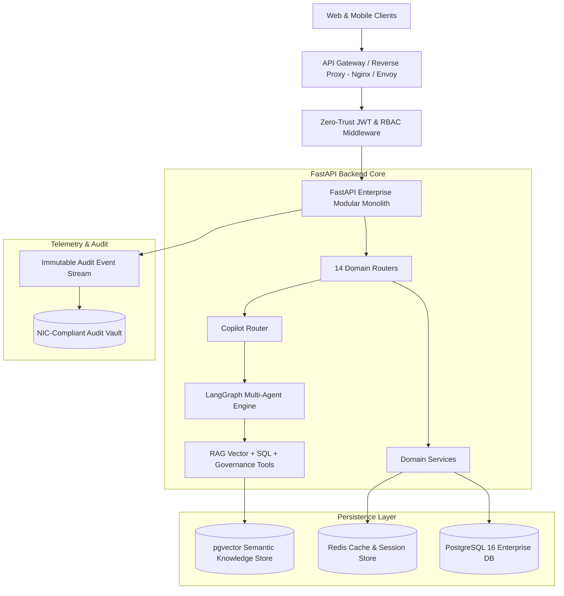

# 09 — Target Enterprise Architecture (To-Be): VETTRI TN AI OS

> [!NOTE]
> Preserves all 108 existing capabilities while unifying data layers, securing all 56 endpoints, and mounting the LangGraph multi-agent engine.

---

## 1. Target System Architecture (To-Be)

---

## 2. Key Architectural Modernization Pillars

1. **Unified Canonical Data Plane**: Single authoritative source for all 787+ administrative officials in PostgreSQL, exposed via cached GraphQL/REST endpoints.
2. **Zero-Trust IAM Enforcement**: Every endpoint protected by OAuth2 / JWT with role claims matching the 6 government personas.
3. **Integrated Agentic Copilot**: Full LangGraph supervisor mounted in `/api/v1/copilot`, offering grounded natural-language queries against real administrative telemetry.
4. **State Data Centre (SDC) Readiness**: Dockerized micro-services deployable to TNeGA / NIC Cloud with SSL, rate limiting, and automated backups.
