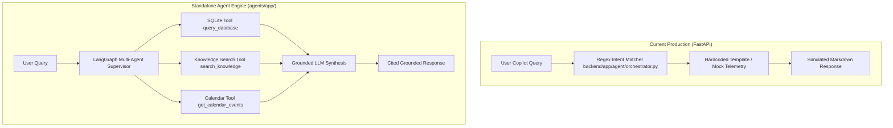

# 11 — AI and Agentic Systems Architecture Audit: VETTRI TN AI OS

> [!NOTE]
> Audit evaluates the dual AI architectures in the repository: the active backend regex orchestrator vs the standalone LangGraph supervisor.

---

## 1. Dual AI Engine Evaluation

---

## 2. Evaluation Findings (`FIND-AI-01`)

1. **Decoupled Supervisor**: The LangGraph engine in `agents/app/` has real agentic capabilities with MCP tools, but is completely bypassed by [copilot.py](file:///Users/apple/projects/vetri-tncm-aios/backend/app/api/v1/copilot.py).
2. **Hallucination Safeguards**: The production API lacks validation guardrails; all responses are static mock strings.
3. **Remediation Plan**:
   - Mount LangGraph into [copilot.py](file:///Users/apple/projects/vetri-tncm-aios/backend/app/api/v1/copilot.py) under `/api/v1/copilot/chat`.
   - Provide LangGraph tools with direct access to PostgreSQL and the canonical directory.
   - Enforce grounded source citation formatting (`[Source: G.O. Ms. No. 123]`) on every model output.
