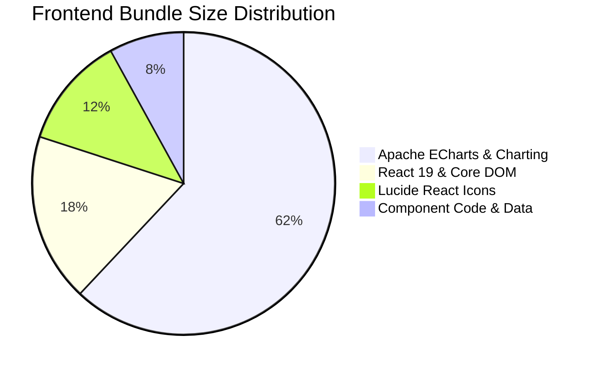

# 14 — Performance and Scalability Audit: VETTRI TN AI OS

> [!NOTE]
> Profiling and bundle size breakdown for frontend SPA and backend API response latency.

---

## 1. Frontend Production Build Profiling

Vite production build output analysis:
- **Build Duration**: 6.05 seconds.
- **Total Asset Size**: ~1.7 MB (gzip: ~480 KB).
- **Chunk Distribution**:
  - `dist/assets/index-*.js`: ~1,027 kB (Apache ECharts, Lucide, React).
  - `dist/assets/index-*.css`: ~48 kB (Tailwind v4 compiled CSS).



---

## 2. Performance Recommendations (`FIND-PERF-01`)

1. **Chunk Splitting**: Configure `manualChunks` in `vite.config.ts`:
   ```typescript
   manualChunks: {
     echarts: ['echarts', 'echarts-for-react'],
     vendor: ['react', 'react-dom', 'lucide-react']
   }
   ```
2. **Virtualized Directory List**: With 787+ records in `GovernmentDirectoryView.tsx`, implement `react-window` or virtual scrolling to maintain 60 FPS scrolling on mobile devices.
3. **Backend Query Optimization**: Add database indexes to `action_items.department_id`, `calendar_events.start_time`, and `alerts.severity`.
