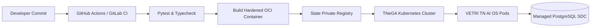

# 15 — DevOps, CI/CD and Deployment Architecture Audit

> [!NOTE]
> Evaluates containerization, GitHub Actions workflows, hosting options, and production deployment paths for Tamil Nadu State Data Centre (TNeGA SDC).

---

## 1. Existing Deployment Architecture

- **Static Deployment**: Hosted on GitHub Pages via GitHub Actions workflow in [.github/workflows/deploy.yml](file:///Users/apple/projects/vetri-tncm-aios/.github/workflows/deploy.yml).
- **SPA Routing Caveat**: On GitHub Pages, direct deep links (e.g., `/contacts`) yield HTTP 404 unless routed via hash (`/#directory`) or `404.html` redirect script.
- **Container Infrastructure**: Root [docker-compose.yml](file:///Users/apple/projects/vetri-tncm-aios/docker-compose.yml) defines services for backend API (`backend/Dockerfile`) and PostgreSQL.

---

## 2. Production Deployment Path (TNeGA State Data Centre)

### Production Hardening Checklist
- [ ] Transition from SQLite to PostgreSQL 16.
- [ ] Enforce HTTPS with TLS 1.3 certificates issued by State Root CA.
- [ ] Configure rate limiting (100 req/min/IP) via Nginx Ingress Controller.
- [ ] Configure automated daily WAL backups to secure SDC block storage.
