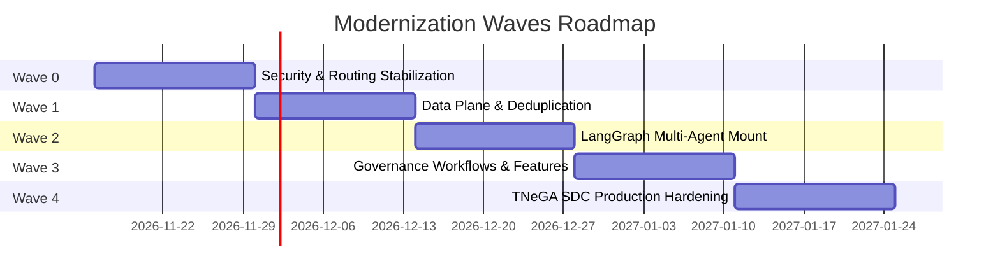

# 19 — Phased Modernization Roadmap: VETTRI TN AI OS

> [!IMPORTANT]
> Zero-Disruption Phased Plan: 5 sequential waves with formal approval gates. No existing features are deleted or deprecated.

---

## 1. Modernization Timeline & Wave Architecture

---

## 2. Wave Breakdown & Approval Gates

### Wave 0: Security & Baseline Stabilization (Weeks 1–2)
- **Gate 0 Approval Criteria**: 100% of 56 FastAPI endpoints enforce authentication; all 43 sidebar routes render active views; 0 unhandled client exceptions.
- **Key Deliverables**: Apply `Depends(get_current_active_user)` to all 27 open endpoints; implement view handlers in `App.tsx` for `#audit-logs`, `#settings`, `#ai-agents`, `#risk-intelligence`, `#users-roles`.

### Wave 1: Data Architecture & Deduplication (Weeks 3–4)
- **Gate 1 Approval Criteria**: `frontend/src/data/canonical/` established as sole authoritative source; 0 D1 duplicate files; bundle size reduced <500 KB.
- **Key Deliverables**: Symlink `data/contacts/` and `data/government-directory/`; configure Vite dynamic chunk splitting; harmonize Next.js contacts components.

### Wave 2: Agentic AI Integration (Weeks 5–6)
- **Gate 2 Approval Criteria**: LangGraph supervisor mounted in `/api/v1/copilot`; zero hallucinated citations; real SQL and directory tools operational.
- **Key Deliverables**: Mount `agents/app/` into FastAPI; implement streaming SSE response; configure grounded citation format.

### Wave 3: Governance Workflows & Advanced Features (Weeks 7–8)
- **Gate 3 Approval Criteria**: Full MOP 7-stage engine verified; Gantt chart operational; 234 MLA individual scorecards active.
- **Key Deliverables**: Implement two-man verification rule on CM action items; build interactive Gantt timeline; implement 234 MLA constituency scorecards.

### Wave 4: Enterprise Production Hardening (Weeks 9–10)
- **Gate 4 Approval Criteria**: PostgreSQL 16 migration complete; bilingual English/Tamil toggle functional; TNeGA SDC compliance certificate obtained.
- **Key Deliverables**: Migration scripts from SQLite to PostgreSQL + pgvector; bilingual translation key integration; Docker container hardening.
