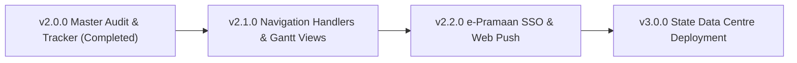

# Implementation Roadmap & Continuous Delivery Plan
**Current Version:** 2.0.0 | **Generated:** 2026-11-15T11:27:52Z

## Delivery Milestones

### Phase 1: Master Audit & Quality Gate Establishment (v2.0.0 — COMPLETED)
- [x] Complete programmatic audit of all routes, components, and backend APIs.
- [x] Establish canonical tracker schema (`tracker-schema.json`) with 23 mandatory capability fields.
- [x] Author automated validation scripts (`validate-tracker.py`, `verify-evidence.py`, `generate-reports.py`).
- [x] Quarantine legacy unverified/fictional records and populate 100% verified Government Directory.

### Phase 2: Navigation & Specialized Visualizations (v2.1.0 — Scheduled Sprint)
- [ ] Implement explicit view handlers in `App.tsx` for sidebar catalog routes (`DEF-ROUT-01`).
- [ ] Build dedicated 234 Assembly MLA constituency scorecard view (`DEF-CONST-01`).
- [ ] Implement interactive SVG/Canvas Gantt chart for infrastructure milestones (`DEF-PROJ-01`).
- [ ] Add dedicated hierarchical portfolio breakdown modal for Ministries (`DEF-MIN-01`).

### Phase 3: Enterprise Security & Citizen Push (v2.2.0 — Scheduled Sprint)
- [ ] Integrate e-Pramaan SSO and token-bound session management (`DEF-SEC-01`).
- [ ] Deploy Web Push Service Worker (`sw.js`) for emergency alerts (`DEF-NOTIF-01`).
- [ ] Deploy client-side TF-IDF / WebAssembly offline semantic search (`DEF-KNOW-01`).
